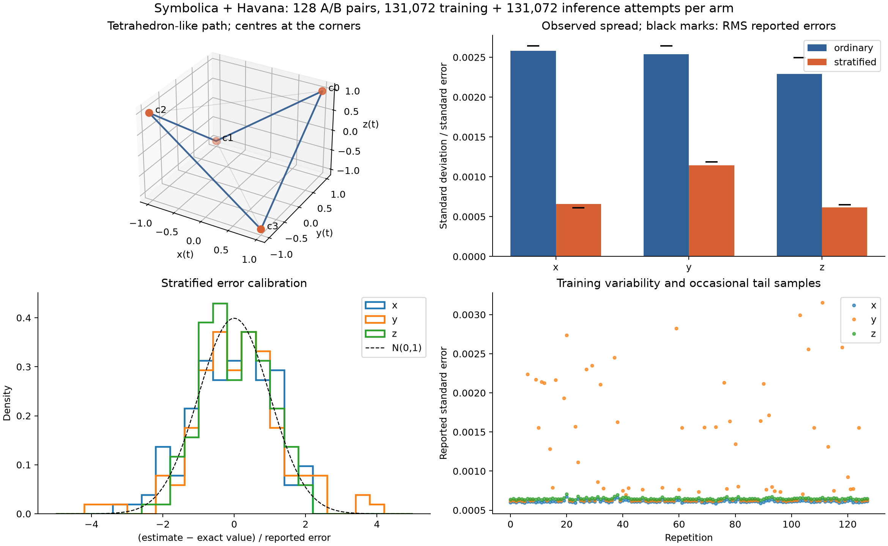

# Scaled Voronoi stratification: tetrahedron path A/B

The experiment integrates the vector path itself over unit parameter time:

\[
I=\int_0^1 (a(t),b(t),a(t)b(t))\,dt,\quad
 a(t)=\tanh(8\cos(2\pi t)),\quad b(t)=\tanh(8\sin(2\pi t)).
\]

The four centres are `(1,1,1)`, `(-1,1,-1)`, `(-1,-1,1)`, `(1,-1,-1)` with
scales `[1,1,1]`. Saturation slows the path near the corners, with smooth
transitions close to four edges of the tetrahedron. This is a parameter-time
integral, not an arc-length integral: there is no extra `|x'(t)|` factor.
The exact result is `[0,0,0]`: shifting by half a period changes the signs of
`a,b`; shifting by a quarter period changes the sign of their product.

Both arms use the real compiled Symbolica evaluator and production Havana
training/inference, materializer, gating and accumulator implementations. Symbolica
uses the equivalent exponential formula for tanh. The benchmark calls those
components in-process; independent PostgreSQL/CLI tests and a deployed dashboard
run exercise distributed queue execution separately.

## Matched experiment

- 128 repeated pairs, with training seeds `10000 + trial` and inference seeds
  `100000 + trial`; run order alternates by trial. A pair shares seed numbers but
  not identical sample locations after the algorithms diverge.
- Each arm: **131,072 training attempts + 131,072 inference attempts**.
- Havana: 64 bins, 4096-sample training windows, training rate 0.5 to 0.1,
  2048-sample evaluator batches, norm training projection.
- A: ordinary pooled Havana, no output partition.
- B: four conditional Havana grids, Voronoi gating, frozen exact label
  probabilities, fresh stratified inference statistics.
- Every miss is charged to the budget and counted as zero. B's inference match
  fraction was **96.95%**. Training costs are included; results exclude training
  observations. Inference uses a fixed budget, without error-dependent stopping.

| Component | Ordinary empirical SD | Stratified empirical SD | Variance reduction | Approx. bootstrap 95% interval |
| --- | ---: | ---: | ---: | ---: |
| x | 0.002583 | 0.000658 | **15.42×** | 11.39–21.03× |
| y | 0.002538 | 0.001145 | **4.91×** | 3.24–7.53× |
| z | 0.002291 | 0.000618 | **13.76×** | 10.03–18.81× |

These correspond to standard-error reductions of **3.93×, 2.22×, 3.71×**.
Bootstrap intervals resample whole pairs and are descriptive Monte Carlo estimates,
not guaranteed bounds. Raw repetitions and settings are in
[tetrahedron-results.json](tetrahedron-results.json); computed metrics are in
[summary.json](summary.json).



## Unexpected behavior and limits

The nominal 95% confidence intervals covered the exact result in **92.97%, 88.28%,
97.66%** of stratified repetitions for x/y/z. The y component has occasional large
importance-weight contributions: reported errors range from about 0.00061 to
0.00315. Its pull standard deviation is 1.26, indicating that individual error
bars are not reliably calibrated at this budget even though average predicted
variance agrees reasonably with the empirical variance.

A follow-up kept the same training budget and increased inference eightfold to
**1,048,576 attempts**, over 64 pairs. Variance reductions were **20.71×, 3.70×,
10.91×**. The y pull SD moved from 1.26 to 1.06, and y coverage improved to 92.19%.
The other coverages were 98.44% for x and 90.63% for z; with 64 repetitions these
are noisy diagnostics. This supports a finite-sample tail explanation but does
not establish universally reliable confidence intervals. All three stratified
ensemble means were within 1.1 ensemble standard errors of zero in the follow-up.
See [long-summary.json](long-summary.json) and
[tetrahedron-long-inference.json](tetrahedron-long-inference.json).

An initial two-pair pilot with only 8192 training attempts produced worse errors
with stratification, before the conditional grids learned the masked regions.
Stratification does not remove the need for adequate training or good proposal
support near cell boundaries. No extra variance floor or arbitrary error inflation
was introduced to hide the tail behavior.

In the development build, median total time per pair-arm was 0.635 s for ordinary
and 1.109 s for stratified in the primary experiment. These shared-host timings
are not a release-performance benchmark. The measured benefit is variance per
matched evaluation budget; the extra classification/covariance work has a cost.

## Reproduce

```bash
cargo run --locked --example stratification_ab -- \
  --trials 128 --training 131072 --inference 131072 \
  --output benchmarks/stratification/tetrahedron-results.json
python benchmarks/stratification/report.py benchmarks/stratification/tetrahedron-results.json

cargo run --locked --example stratification_ab -- \
  --trials 64 --training 131072 --inference 1048576 \
  --output benchmarks/stratification/tetrahedron-long-inference.json
python benchmarks/stratification/report.py \
  benchmarks/stratification/tetrahedron-long-inference.json --output-prefix long-
```

The plotter requires NumPy and Matplotlib. The result files include source/build
identity and full settings. Measurements were made on the development worktree;
subsequent display/validation changes do not alter the fixed-budget estimator.

For distributed execution, use the matching
[stratified](../../resources/templates/runs/tetrahedron-stratified.toml) and
[ordinary](../../resources/templates/runs/tetrahedron-ordinary.toml) cards.
Both were validated and executed in an isolated model-3 deployment. The ordinary
run was assigned workers through the webapp; the completed stratified task exposed
per-stratum attempted/matched counts, probabilities and component estimates without
browser errors. The sampler summary now displays the lifted sampling domain.
