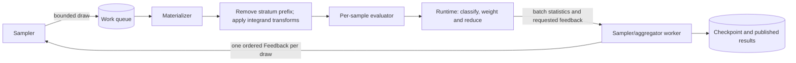

# Sampling and evaluation execution model

This specifies the current GammaBoard pipeline, from generation through feedback
and durable recovery. It applies to native Rust implementations and process
adapters. The [wire protocol](../process_api/protocol.md) specifies message and
array encoding; the [process guide](../process_api/README.md) covers Python worker
setup and callback signatures. Configuration syntax is in [configuration](config.md);
[stratification](stratification.md) specifies partitioning and statistical estimators.

## Ownership and flow

**Evaluator model:** a numerical function of one integrand point. It emits one
unweighted component vector and, optionally, one observable bundle per input.
A batch is a throughput optimization: count, order and grouping by original
sample are preserved. Evaluators do not apply outer sampling weights, classify
strata, accumulate across calls or change results according to worker placement.
Caches are allowed when they do not change numerical results.

**Sampler model:** a stateful proposal generator and optional adaptation algorithm.
It owns RNG state, proposal parameters, training windows and private pending draws.
It generates points (or replayable latent samples) with complete integration
weights, consumes one ordered `Feedback` per feedback-bearing draw, and snapshots
all private state. It does not aggregate the reported integral or observables.
`pdf` and `discrete_mass` are optional queries; exact complete-prefix masses become
mandatory when a task requests stratified inference.

**Runtime model:** GammaBoard owns materialization, transforms, prefix removal,
classification, zero accounting, weighting, statistical reduction and feedback
assembly. Ordinary and stratum-aware samplers use the same interfaces.



The sampler/aggregator worker owns the task accumulator and merges accepted batch
results; the sampler object owns only sampling/training state. Evaluator workers
execute independent fragments of draws. The runtime restores original order for
feedback even if fragments finish out of order.

At task activation, GammaBoard resolves sources, builds or restores the sampler,
and saves the initial checkpoint. It then generates bounded work, queues fragments,
validates whole batch results, merges statistics and publishes progress. Pause and
completion checkpoint the sampler, accumulator and pending-work boundary. The
control plane places workers and manages durable campaign allowances. The database
holds definitions, claims, accepted results and recovery state; dashboard snapshots
are observations, not recovery checkpoints.

## Runtime interfaces

The Rust contracts are [`Sampler`](../src/sampling/sampler.rs) and
[`Evaluator`, `Materializer`, `BatchTransform`](../src/evaluation/traits.rs).
Implementations are `Send`; their methods are called serially within an owning
worker. Concurrency comes from independent workers and queued batches.

| Interface | Required methods | Optional methods and defaults |
| --- | --- | --- |
| `Sampler` | `validate_domain(&Domain)`, `generate(usize) -> Generation`, `feedback(&Feedback)`, `snapshot() -> JSON` | `pdf_batch(points)` and `discrete_mass_batch(subspaces)` return unavailable entries; `persisted_output()` returns no output; `diagnostics()` returns `{}`; `checkpoint_committed(snapshot)` is a no-op |
| `Materializer` | `materialize_batch(&LatentBatch) -> Batch` | `validate_domain(&Domain)` succeeds by default |
| `BatchTransform` | `apply(Batch) -> Batch` | `validate_domain(&Domain)` succeeds by default |
| `Evaluator` | `domain() -> Domain`; implement `eval_values(&Batch, components) -> Vec<f64>` or `eval_samples(&Batch, components, emit)` | `eval_samples` adapts `eval_values` by default; metadata/diagnostics return `{}`; the observable training projection defaults to `abs` |

Fallible methods return `Result<..., EngineError>`; metadata/diagnostics return
JSON directly. `EvaluatorBatch::eval_batch` is a runtime-owned blanket implementation,
not an evaluator extension point. `SamplingConfig` owns construction identity:
the `SamplerConfig` algorithm, optional materializer, optional ordered transforms,
and optional stratification partition. Tasks refer to it through the `sampler`
field. The worker role is called `sampler_aggregator`
because the worker also accumulates completed results.

## Samples, domains, and queue payloads

A concrete [`Point`](../src/evaluation/batch.rs) has:

- `discrete: Vec<i64>`: the discrete branch/coordinate path;
- `continuous: Vec<f64>`: that branch's continuous coordinates;
- `weight_factors: Vec<{label, value}>`: factors whose product is the total weight.

`Point::new` records its supplied weight as `sampler_weight`. A concrete `Batch`
is an ordered list of points. Index `i` identifies the same logical sample through
materialization, transforms, evaluation, and feedback. Implementations must preserve
the sample count and order; filtering or reordering requires a different contract.

A [`Domain`](../src/utils/domain.rs) describes coordinate structure and axis roles,
not a proposal distribution, statistical independence, or integration bounds.

```json
{"rectangular":{"strata_dims":2,"discrete_cardinalities":[2,2,3],"continuous_dims":4}}
```

A rectangular node marks its first `strata_dims` discrete coordinates as strata;
the remainder are integrand coordinates. A branching node has `axis_role` equal to
`"stratum"` or `"integrand"`, an optional display `axis_label`, and ordered branches:
`{"discrete":{"axis_role":"stratum","axis_label":null,"branches":[{"index":0,"domain":...},...]}}`.
Branch labels are nonnegative, unique, increasing integers; gaps are allowed.
Roles default to integrand and rectangular `strata_dims` defaults to zero.

Strata are left-bound along each path: no stratum coordinate may follow an
integrand coordinate. Prefix lengths may differ between branches. For example,
`(0)`, `(1,0)`, `(1,1)`, `(1,3)` are valid complete stratum prefixes. A complete
prefix cannot also be a prefix of another stratum. Remaining integrand layouts
may also vary by branch.

Each role receives the complete domain for its coordinate space: samplers and
materializers see the augmented sampling domain; evaluators and integrand transforms
see the integrand domain after prefix removal. Python uses typed `Domain`, `DiscreteDomain`, `RectangularDomain`, `DomainBranch`,
and `DiscreteAxisRole` objects. `domain.require_rectangular_shape()` is an explicit
convenience for algorithms requiring homogeneous contiguous coordinate arrays.
The shared SDK codec supports ragged rows: a fixed-width coordinate block is a
writable `(N,D)` NumPy array; a variable-width block is a tuple of writable 1D arrays.
Discrete and continuous blocks can independently be fixed or ragged. No padding,
truncation, or loss of branch labels occurs.

[`LatentBatch`](../src/sampling/latent_batch.rs) is the sampler-to-queue value:
`{nr_samples, payload}`. It need not contain fully materialized points. Current
payloads are:

| Payload kind | Contents and interpretation |
| --- | --- |
| `indexed_batch` | `discrete_signatures` is a dictionary of discrete coordinate rows; `discrete_map[i]` selects sample `i`'s row. `continuous_layouts[i]` gives its continuous width; `continuous_values` concatenates those rows. `weights[i]` is the sampling weight. All per-sample arrays have `nr_samples` entries, and the continuous widths sum to the flat coordinate length. |
| `havana_inference` | `rng_states` and `offset` describe replayable draws from a frozen Havana grid. RNG checkpoints bound replay at split points. The built-in materializer reconstructs coordinates and sampling weights using the stage's saved grid. Treat RNG state as implementation-owned serialized state. |

Process samplers return coordinate arrays on the wire; GammaBoard wraps them in
`indexed_batch` payloads. They cannot introduce arbitrary new latent payload kinds.

An `EvaluationBatch` wraps the latent samples and the resolved accumulator
configuration. Claim metadata supplies the batch/task identifiers and feedback
flag separately. Queue encoding is a versioned internal format; external workers
use the process protocol instead of decoding PostgreSQL queue bytes.

## Generation, splitting, and training windows

`generate(max_samples)` receives a **positive per-call upper bound**. It can change
between calls. A sampler returns exactly one of:

| Result | Meaning |
| --- | --- |
| `Batch { batch, training_remaining: None }` | Generate 1..`max_samples` inference samples; no feedback is requested for this draw. |
| `Batch { batch, training_remaining: Some(R) }` | Generate a feedback-bearing draw of size `N`, with `R >= N`. `R` counts the ungenerated samples in the current training window **before this draw**, including its `N` samples. |
| `Waiting` | No draw is available until outstanding feedback permits progress. It does not finish the task. |
| `Finished` | Generation is permanently finished for this sampler state. Existing batches and feedback drain before the task completes. |

An empty draw is invalid. `Waiting` is a feedback dependency, not a mechanism for
waiting indefinitely for an unrelated external event. A sampler with no possible
progress fails instead of silently finishing its task.

Three sizes are independent:

- **Draw size:** one `generate` result; limited by `max_generation_size` and budgets.
- **Evaluator batch size:** one queue item; controlled by fixed/adaptive queue tuning
  and `max_batch_size`. A draw can be consumed over several runtime ticks.
- **Training-window size:** sampler-owned adaptation boundary; it can span draws.

The runtime never changes the sampler's training policy. It uses the declared
window to size work and knows whether to request feedback. The sampler decides
when to return `Waiting`, consume pending feedback, update its model, or finish.

For example, a six-sample training window can produce two draws of three samples:
their `training_remaining` values are six and three. If the evaluator batch size
is two, each draw is split into fragments of two and one. Regardless of evaluation
completion order, the sampler receives two `feedback` calls, each with three
values, in original draw order. It does not receive one call per queue fragment
or one six-value call for the whole training window.

Private sample buffers belong in sampler state. The runtime tracks the split
cursor, remaining latent samples, and partially assembled feedback. Sampling
without feedback does not require storing private training buffers.

## Materialization and transforms

Materialization runs on evaluator workers **after** a queue fragment is claimed.
It maps one latent sample to one concrete point. An omitted materializer selects
the algorithm's built-in implementation: identity decoding for ordinary indexed
draws, or frozen-grid replay for Havana inference. A configured process
materializer overrides that choice.

Transforms run on the resulting concrete batch in configured order. They can
change coordinates and add Jacobian/importance factors, while preserving sample
identity, count, and a layout accepted by the run domain. A process transform
receives the current **total** weights and returns the replacement **total** weights;
it must include earlier factors in that result. GammaBoard does not multiply the
old total into the returned total again.

If a sample has sampling weight `w` and successive Jacobians `J1`, `J2`, the
evaluator-side total is `W = w * J1 * J2`. Process sampler/materializer/transform
weights must be finite and strictly positive. Signed integrands and signed
campaign coefficients are separate from those sampling weights.

For a normalized proposal density `p` relative to the desired integration measure,
the sampling weight is `1/p`; include volume and discrete-choice factors where
needed. The weight returned by generation must contain the complete sampling
correction. Native uniform sampling multiplies the cardinalities of every chosen
discrete branch/axis, including the stratum axis, into its inverse-density weight;
it integrates the discrete sum rather than the average over labels.
`pdf` returns an already normalized joint density in sampling coordinates.
`discrete_mass` returns exact normalized marginals. Either may return unavailable
entries; this never relaxes the requirement for complete generated weights.
For joint proposal `q(s,d,x) = p_s q(d,x|s)`, the conditional density is `q/p_s`.
After transforms, the total evaluator weight is `J/q`, not generally `1/q`.

Materializers and transforms have no snapshot/restore callback. Their output must
be reproducible from the supplied batch, immutable configuration, and immutable
referenced artifacts. Worker-local caches are allowed; correctness must not depend
on which worker receives a fragment, its partition size, or a previous invocation.
The same restriction applies to evaluator-private state that affects results.

Task-level `batch_transforms` overrides pipeline transforms. An omitted field
inherits the effective pipeline/preceding-stage transforms; an explicit empty
array clears them. See [task sources](config.md#task-sources-and-training).

## Evaluation, weights, and the return path

`EvalBatchOptions` contains the runtime partition context and `require_training_values`.
Evaluators emit unweighted `SampleOutput` records; the runtime reducer returns:

```text
BatchResult {
    accumulator: AccumulatorState,
    feedback: Option<Feedback>
}
```

The accumulator is the result for **this batch**, not the run's previous state.
Feedback must be present exactly when requested, with one finite scalar per input
sample in input order. Its length and every statistical accumulator count equal
the claimed sample count. Empty storage discards data after validating the number
of emitted sample outputs.

`Feedback` contains `unmasked_values` and optional `strata`. The latter stores a
canonical table of complete prefix tuples and one requested/actual table index per
sample. Rust `requested_prefixes()` / `actual_prefixes()` and Python `.requested` /
`.actual` expose those tuples. The compact indices avoid repeating variable-length
prefixes for every sample. `Feedback.values()` in Rust / `.values` in Python is the
GammaBoard-owned masked view: misses become zero. Generic samplers consume this
view without understanding strata. Both views are **already weighted**,
`W * projection(f)`; the sampler must not multiply by W again. An aware sampler can
use the unmasked projection and actual prefix to improve training; it must account for the proposal
that generated the point, and any branch-dependent inverse maps/Jacobians. Relabeling
a point never changes its original sampling density or inference assignment.

Feedback is assembled in original draw order, including its prefix table and both
assignment arrays. Partial feedback survives checkpoint recovery. No sampler
awareness or invertibility flag changes runtime behavior. Feedback does not resend
coordinates or weights; a training algorithm retains those in private pending
state when it needs them.

### Ordinary values

An ordinary process callback returns unweighted values: one named component vector
per sample. For total weight `W_i` and unweighted component `f_ij`, the runtime
accumulates `W_i * f_ij`. Feedback is `W_i * projection(f_i)`; a component projection
preserves the sign, and a norm projection computes the vector norm. The callback
must not multiply by the sampling weight itself.

`scalar` is statistical vector component `value`. Statistical vectors retain
moments for estimates/uncertainties and support adaptation feedback. `full_vector`
collects weighted component rows for inference/plotting; it has no training
projection. Use a statistical accumulator for feedback-bearing draws.

Invalid dimensions, non-finite values, or overflowing accumulator moments reject
the whole result. They do not silently remove samples, substitute zero, publish
partial accumulator updates, or feed the sampler an accepted partial result.

### GammaLoop/observable output

Native GammaLoop and process observable evaluators emit one unweighted result
per input draw. Ordinary values and observables use the same evaluation boundary:
no evaluator returns a statistical accumulator. Batching changes throughput, not
the statistical unit. GammaBoard rejects missing/extra results, non-finite values,
histograms with sample counts other than one, and per-sample squared bin sums
that do not equal the square of the complete sample contribution.

Python `eval(xs_discrete, xs_continuous)` returns either component arrays or
`ObservableBatch(values, observables)`. Observable values are `(N,2)` real/imaginary
values, and `observables` contains N GammaLoop-compatible histogram bundles.
Each histogram counts the original draw once, including empty fills; correlated
events from that draw are summed per bin before squaring. Callbacks receive neither
sampling weights nor partition metadata. Configure `output = { kind = "gammaloop",
training_projection = "real" }` (real is the default; also imag, abs, abs_sq).
The runtime applies the outer weight once to values, observables and feedback.

Rust `Evaluator::eval_samples` emits `SampleOutput` through a runtime-owned sink.
The default implementation adapts `eval_values` arrays. Native GammaLoop consumes events one sample at a time; the process protocol buffers
a batch of per-sample bundles.
Only reduced batch statistics and requested feedback cross the worker queue.

### Aggregation and feedback

Workers may finish fragments out of order. Ordered result ingestion and the
runtime's draw buffer restore the original feedback order. Each feedback-bearing draw
gets one complete feedback array per execution history. Batch accumulators merge
into the task's accumulator; progress and measurement projection derive from the
accepted history. A sampler can transform signed feedback internally for its
training algorithm, but the runtime does not replace it with absolute values.

## Sample budgets

A sample task's `max_samples` limits generation. Completed, queued, and buffered
samples already consume its remaining allocation. Error targets can stop new work
before that maximum; queued work may still drain. A generator's `Finished` result
can also end its task after outstanding work drains.

A campaign's `max_total_samples` caps logical samples across **all child stages**,
including training and plotting. Before workers generate samples, the controller
grants disjoint, durable child allowances whose sum cannot exceed the cap. Error-only
campaigns use the same grants without a global cap. Each grant is one child's
scheduling quantum, bounded by `allocation_window_samples`; pilot grants can be
smaller. The sampler subtracts previous-stage production and its current
produced/buffered work. Waiting for another grant is not sampler exhaustion.

A child retains its slot until that grant drains, independently of the other
children. Renewing a grant preserves the running sampler; replacing a child
checkpoints it through the existing worker handoff. Unfinished grants and live
placements identify incumbents after controller recovery, including a crash
between grant, placement and output publication. Retained children keep their
workers up to their balanced evaluator share. Resource shortages reduce active
concurrency according to the sampler count and the minimum evaluator allocation.
See [campaign allocation](config.md#controllers) for configuration.

An error target first prevents new grants while existing quanta drain. The target
is checked again on the resulting estimates, and completion is published only
after retiring workers release their placements and save their checkpoints.

Pilot grants and scheduling windows cannot bypass the cap. Completed child queues
return unused allowance; paused/active children retain reservations for buffered
or queued work. A cap too small to reach every child's final usable publishing
stage fails explicitly. Error convergence waits for the final publishing stages
and their progress publication.

The cap counts logical sample slots, not physical evaluator calls or CPU time.
Retries and recovery can execute a slot again. The cost of evaluating one point
may vary; every emitted result must still describe that original point.

## Tasks, checkpoints, and failures

There are three distinct initialization paths:

| Path | State and counters |
| --- | --- |
| Fresh configuration | Construct a new sampler with its configured seed/arguments and the current evaluator metadata. |
| Supported stage handoff | Initialize a new task from an earlier saved sampler, for example Havana training → inference or a PDF diagnostic. Destination parameters apply; source work counters and pending work are not resumed. |
| Checkpoint recovery | Restore the exact saved sampler construction configuration and private state, accumulator, draw cursor/feedback fragments, queue cursors, and progress. |

Accumulator selection is independent of sampler handoff. Continuing an earlier
accumulator retains its statistics; an explicit accumulator configuration starts
fresh statistics. Task work counters count the new task's execution in either
case. Use a fresh inference accumulator when training samples should be excluded
from the reported estimate.

`SavedSampler` is `{version, config, state}`. `state` must be non-null JSON and must
contain all private RNG/adaptation state required by future `generate` and
`feedback` calls, including any draws already awaiting feedback. Construction
configuration is stored separately. `persisted_output()` is optional task output;
it is not a replacement for `snapshot()`.

Samplers may implement `checkpoint_committed(snapshot)`. After the database save
succeeds, GammaBoard passes back the exact opaque state returned by `snapshot()`,
without the saved-sampler envelope. This notification covers activation, periodic
saves, pause and completion. Its default implementation does nothing.
Callback errors do not undo the committed checkpoint or reset its cadence;
notifications retry after 30 seconds while the runner is active. A newer save
attempt supersedes any older pending notification, even if that attempt fails:
an uncertain database commit must never be followed by a stale cleanup signal.
Notifications may repeat or be missed on exit. Implement the callback idempotently
and also establish committed state in `from_snapshot`. A successful notification
does not authorize deleting artifacts still referenced by stages, other tasks or
backups. Ordinary generation/feedback/diagnostic calls are not commit signals.

Initial activation, periodic task thresholds, graceful pause, and task completion
save checkpoints. The [checkpoint policy](config.md#checkpoint-policy) configures
periodic triggers. Thresholds restart after a successful commit; restoration starts
a new elapsed-time interval from the recovered sample count. Downtime, inherited
run uptime and inherited accumulator samples do not trigger an immediate save.
Saves occur between ticks, after flushing pending inserts, aggregation and progress
writes; a long callback can delay the trigger. Periodic saves replace the active
checkpoint without adding named stage snapshots. Failed saves retain the previous
boundary and retry after 30 seconds while sampling continues.

Recovery validates the saved boundary, removes later speculative work, rolls back live
progress, and replays retained work consistently. Completed task/stage history is
separate from the live accumulator. A new publishing stage cannot reuse a previous
stage's live result as evidence that it has already sampled.

Claims and submissions use ownership tokens. An expired/superseded worker cannot
publish its late result as the current claim. Batch errors follow the queue retry
policy (`max_batch_retries`); persistent failures fail visibly. Callback errors
and native panics become task/batch failures rather than accepted numerical data.

Recovery preserves accepted history, not exactly-once external side effects.
Materialization, evaluation, and feedback after a checkpoint can be replayed.
External callbacks must tolerate replay; external sampler artifacts must remain
immutable, durable, and accessible wherever a resumed worker runs. Database
backups do not copy those files. See [operations](operations.md#backup-and-recovery)
for operator commands and [format compatibility](compatibility.md) for supported
state/protocol versions.

### Database retries

Sampler batch insertions preserve explicit PostgreSQL abort codes. Lock timeouts
(`55P03`), deadlocks (`40P01`), and serialization failures (`40001`) retry the whole
insertion transaction with the same batch IDs, payloads, and feedback flag.
Retries use exponential backoff with jitter, capped at five seconds. The failed
bundle remains an ordering barrier; worker lease/control checks run between
attempts. These errors do not restart the sampler or reset its progress. Other
insertion errors, including connection loss with an unknown commit outcome,
retain the conservative checkpoint-recovery behavior. These retries are separate
from evaluator `max_batch_retries` and do not re-evaluate completed samples.

## Process implementations

Native and process implementations obey the same ownership and replay contract.
Use the [process-worker guide](../process_api/README.md#python-callbacks) for Python
constructors, callback signatures, array shapes and the standalone sampler checker.
The [wire protocol](../process_api/protocol.md) defines JSON-RPC and binary framing
for workers written in any language.
