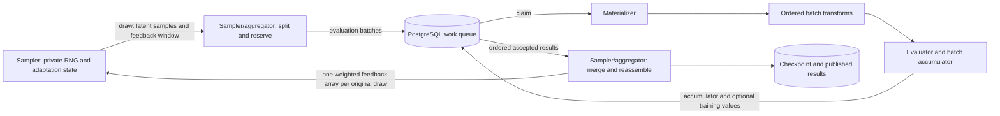

# Sampling and evaluation execution model

This specifies the current GammaBoard pipeline, from generation through feedback
and durable recovery. It applies to native Rust implementations and process
adapters. The [wire protocol](../process_api/protocol.md) specifies message and
array encoding; the [process guide](../process_api/README.md) covers Python worker
setup. Configuration syntax is in [configuration](config.md).

## Ownership and flow



The **sampler/aggregator worker** owns one active task's sampler, draw buffer,
feedback assembly, and cumulative accumulator. The sampler itself owns its RNG,
adaptation algorithm, training-window policy, and any private pending samples.

Each **evaluator worker** builds the effective task's materializer, transforms,
and evaluator. It claims independently executable batches and returns a fresh
batch accumulator plus feedback when requested. Several evaluator workers may
process fragments of the same draw concurrently.

The **control plane** activates tasks and places workers. A controller manages
ordinary child runs through its root worker pool. Campaign budget reservations
are durable control-plane state, not sampler-private counters.

The **database** holds definitions, claims, results, published snapshots, and
recovery checkpoints. Dashboard snapshots are observations; a saved checkpoint
is the boundary used to recover sampler execution.

For a sampling task, the execution sequence is:

1. Resolve the evaluator, sampler, accumulator, and transform sources. The first
   evaluator establishes the run domain; subsequent stages preserve that domain.
2. Obtain evaluator metadata and construct or restore the sampler. Metadata is
   JSON supplied by `Evaluator::metadata()`; it is not a sample or a result.
3. Save the initial checkpoint before producing work. A new sampling/plotting
   stage invalidates the previous live accumulator when it activates.
4. Request a bounded draw from `generate(max_samples)`. Retain its latent payload
   and feedback-window declaration, then split it into evaluator batches.
5. Queue each fragment with its task identity, resolved accumulator configuration,
   and `requires_training_values` flag. Evaluators claim work with ownership tokens.
6. Materialize each fragment, apply transforms in order, evaluate it, and validate
   the entire result before publishing the batch result.
7. Read accepted results in generation order, assemble feedback by original draw,
   call the sampler's feedback method, and merge batch accumulators.
8. Publish progress/results and check stopping conditions. Task completion and
   pause save the sampler, accumulator, queued-work boundary, and pending feedback.

## Runtime interfaces

The Rust contracts are [`Sampler`](../src/sampling/sampler.rs) and
[`Evaluator`, `Materializer`, `BatchTransform`](../src/evaluation/traits.rs).
Implementations are `Send`; their methods are called serially within an owning
worker. Concurrency comes from independent workers and queued batches.

| Interface | Required methods | Optional methods and defaults |
| --- | --- | --- |
| `Sampler` | `validate_domain(&Domain)`, `generate(usize) -> Generation`, `feedback(&[f64])`, `snapshot() -> JSON` | `pdf_batch(points)` and `discrete_pdf_batch(subspaces)` return unavailable entries; `global_pdf_norm()` returns 1; `persisted_output()` returns no output; `diagnostics()` returns `{}` |
| `Materializer` | `materialize_batch(&LatentBatch) -> Batch` | `validate_domain(&Domain)` succeeds by default |
| `BatchTransform` | `apply(Batch) -> Batch` | `validate_domain(&Domain)` succeeds by default |
| `Evaluator` | `domain() -> Domain`, `eval_batch(&Batch, &AccumulatorConfig, EvalBatchOptions) -> BatchResult` | `metadata()` and `diagnostics()` return `{}` |

Fallible methods return `Result<..., EngineError>`; metadata/diagnostics return
JSON directly. `SamplingConfig` owns construction identity: the `SamplerConfig`
algorithm, optional materializer, and optional ordered transforms. Tasks refer to
it through the `sampler` field. The worker role is called `sampler_aggregator`
because the worker also accumulates completed results.

## Samples, domains, and queue payloads

A concrete [`Point`](../src/evaluation/batch.rs) has:

- `discrete: Vec<i64>`: the discrete branch/coordinate path;
- `continuous: Vec<f64>`: that branch's continuous coordinates;
- `weight_factors: Vec<{label, value}>`: factors whose product is the total weight.

`Point::new` records its supplied weight as `sampler_weight`. A concrete `Batch`
is an ordered list of points. Index `i` identifies the same logical sample through
materialization, transforms, evaluation, and feedback. Implementations must preserve
the sample count and order; filtering or reordering requires a different contract.

A [`Domain`](../src/utils/domain.rs) describes coordinate structure, not the
sampler distribution or physical integration bounds:

```json
{"rectangular":{"discrete_cardinalities":[3,2],"continuous_dims":4}}
```

Each rectangular discrete coordinate ranges from zero to its cardinality minus
one. A branching domain is
`{"discrete":{"axis_label":null,"branches":[{"index":0,"domain":...},...]}}`.
The selected branch determines the remaining coordinate layout. Native and direct
wire implementations can support varying row widths. The Python SDK requires a
homogeneous layout with zero-based contiguous branch choices, and rejects varying
coordinate widths.

[`LatentBatch`](../src/sampling/latent_batch.rs) is the sampler-to-queue value:
`{nr_samples, payload}`. It need not contain fully materialized points. Current
payloads are:

| Payload kind | Contents and interpretation |
| --- | --- |
| `indexed_batch` | `discrete_signatures` is a dictionary of discrete coordinate rows; `discrete_map[i]` selects sample `i`'s row. `continuous_layouts[i]` gives its continuous width; `continuous_values` concatenates those rows. `weights[i]` is the sampling weight. All per-sample arrays have `nr_samples` entries, and the continuous widths sum to the flat coordinate length. |
| `havana_inference` | `rng_states` and `offset` describe replayable draws from a frozen Havana grid. RNG checkpoints bound replay at split points. The built-in materializer reconstructs coordinates and sampling weights using the stage's saved grid. Treat RNG state as implementation-owned serialized state. |

Process samplers return coordinate arrays on the wire; GammaBoard wraps them in
`indexed_batch` payloads. They cannot introduce arbitrary new latent payload kinds.

An `EvaluationBatch` wraps the latent samples and the resolved accumulator
configuration. Claim metadata supplies the batch/task identifiers and feedback
flag separately. Queue encoding is a versioned internal format; external workers
use the process protocol instead of decoding PostgreSQL queue bytes.

## Generation, splitting, and training windows

`generate(max_samples)` receives a **positive per-call upper bound**. It can change
between calls. A sampler returns exactly one of:

| Result | Meaning |
| --- | --- |
| `Batch { batch, training_remaining: None }` | Generate 1..`max_samples` inference samples; no feedback is requested for this draw. |
| `Batch { batch, training_remaining: Some(R) }` | Generate a feedback-bearing draw of size `N`, with `R >= N`. `R` counts the ungenerated samples in the current training window **before this draw**, including its `N` samples. |
| `Waiting` | No draw is available until outstanding feedback permits progress. It does not finish the task. |
| `Finished` | Generation is permanently finished for this sampler state. Existing batches and feedback drain before the task completes. |

An empty draw is invalid. `Waiting` is a feedback dependency, not a mechanism for
waiting indefinitely for an unrelated external event. A sampler with no possible
progress fails instead of silently finishing its task.

Three sizes are independent:

- **Draw size:** one `generate` result; limited by `max_generation_size` and budgets.
- **Evaluator batch size:** one queue item; controlled by fixed/adaptive queue tuning
  and `max_batch_size`. A draw can be consumed over several runtime ticks.
- **Training-window size:** sampler-owned adaptation boundary; it can span draws.

The runtime never changes the sampler's training policy. It uses the declared
window to size work and knows whether to request feedback. The sampler decides
when to return `Waiting`, consume pending feedback, update its model, or finish.

For example, a six-sample training window can produce two draws of three samples:
their `training_remaining` values are six and three. If the evaluator batch size
is two, each draw is split into fragments of two and one. Regardless of evaluation
completion order, the sampler receives two `feedback` calls, each with three
values, in original draw order. It does not receive one call per queue fragment
or one six-value call for the whole training window.

Private sample buffers belong in sampler state. The runtime tracks the split
cursor, remaining latent samples, and partially assembled feedback. Sampling
without feedback does not require storing private training buffers.

## Materialization and transforms

Materialization runs on evaluator workers **after** a queue fragment is claimed.
It maps one latent sample to one concrete point. An omitted materializer selects
the algorithm's built-in implementation: identity decoding for ordinary indexed
draws, or frozen-grid replay for Havana inference. A configured process
materializer overrides that choice.

Transforms run on the resulting concrete batch in configured order. They can
change coordinates and add Jacobian/importance factors, while preserving sample
identity, count, and a layout accepted by the run domain. A process transform
receives the current **total** weights and returns the replacement **total** weights;
it must include earlier factors in that result. GammaBoard does not multiply the
old total into the returned total again.

If a sample has sampling weight `w` and successive Jacobians `J1`, `J2`, the
evaluator-side total is `W = w * J1 * J2`. Process sampler/materializer/transform
weights must be finite and strictly positive. Signed integrands and signed
campaign coefficients are separate from those sampling weights.

For a normalized proposal density `p` relative to the desired integration measure,
the sampling weight is `1/p`; include volume and discrete-choice factors where
needed. The weight returned by generation must contain the complete sampling
correction. Native uniform sampling multiplies the cardinalities of every chosen
discrete branch/axis, including the stratum axis, into its inverse-density weight;
it integrates the discrete sum rather than the average over labels.
`global_pdf_norm()` describes PDF diagnostics and does not automatically rescale
ordinary evaluation results.

Materializers and transforms have no snapshot/restore callback. Their output must
be reproducible from the supplied batch, immutable configuration, and immutable
referenced artifacts. Worker-local caches are allowed; correctness must not depend
on which worker receives a fragment, its partition size, or a previous invocation.
The same restriction applies to evaluator-private state that affects results.

Task-level `batch_transforms` overrides pipeline transforms. An omitted field
inherits the effective pipeline/preceding-stage transforms; an explicit empty
array clears them. See [task sources](config.md#task-sources-and-training).

## Evaluation, weights, and the return path

`EvalBatchOptions` contains `require_training_values`. A Rust evaluator returns:

```text
BatchResult {
    accumulator: AccumulatorState,
    training_values: Option<Vec<f64>>
}
```

The accumulator is the result for **this batch**, not the run's previous state.
Feedback must be present exactly when requested, with one finite scalar per input
sample in input order. Its length is the claimed sample count, even for an
observable adapter whose internal integration counts differ.

### Ordinary values

An ordinary process callback returns unweighted values: one named component vector
per sample. For total weight `W_i` and unweighted component `f_ij`, the Rust adapter
accumulates `W_i * f_ij`. Feedback is `W_i * projection(f_i)`; a component projection
preserves the sign, and a norm projection computes the vector norm. The callback
must not multiply by the sampling weight itself.

`scalar` is statistical vector component `value`. Statistical vectors retain
moments for estimates/uncertainties and support adaptation feedback. `full_vector`
collects weighted component rows for inference/plotting; it has no training
projection. Use a statistical accumulator for feedback-bearing draws.

Invalid dimensions, non-finite values, or overflowing accumulator moments reject
the whole result. They do not silently remove samples, substitute zero, publish
partial accumulator updates, or feed the sampler an accepted partial result.

### GammaLoop/observable output

A GammaLoop process callback receives total weights and returns a
`GammaLoopBatchResult` containing native accumulator JSON and optional training
values. It applies the supplied weights **exactly once** to both state and
feedback. GammaBoard validates and merges the state; it does not reweight it.
When feedback is not requested, `training_values` must be absent/`None`.

Observable adapters can represent an independent native integration, such as a
one-trigger MadGraph calculation. Their internal accumulator counts can differ
from the number of queued input samples. Queue/task work accounting still counts
those input samples. This is why accumulator sample counts, task counts, and
whole-run counts need not be identical.

### Aggregation and feedback

Workers may finish fragments out of order. Ordered result ingestion and the
runtime's draw buffer restore the original feedback order. Each feedback-bearing draw
gets one complete feedback array per execution history. Batch accumulators merge
into the task's accumulator; progress and measurement projection derive from the
accepted history. A sampler can transform signed feedback internally for its
training algorithm, but the runtime does not replace it with absolute values.

## Sample budgets

A sample task's `max_samples` limits generation. Completed, queued, and buffered
samples already consume its remaining allocation. Error targets can stop new work
before that maximum; queued work may still drain. A generator's `Finished` result
can also end its task after outstanding work drains.

A campaign's `max_total_samples` caps logical samples across **all child stages**,
including training and plotting. Before workers generate samples, the controller
grants disjoint, durable child allowances whose sum cannot exceed the cap. The
sampler subtracts previous-stage production and its current produced/buffered
work. Waiting for another grant is not sampler exhaustion.

Pilot grants and scheduling windows cannot bypass the cap. Completed child queues
return unused allowance; paused/active children retain reservations for buffered
or queued work. A cap too small to reach every child's final usable publishing
stage fails explicitly. Error convergence waits for the final publishing stages
and their progress publication.

The cap counts logical sample slots, not physical evaluator calls or CPU time.
Retries and recovery can execute a slot again. Observable adapters' internal
integration effort is also outside this input-sample count.

## Tasks, checkpoints, and failures

There are three distinct initialization paths:

| Path | State and counters |
| --- | --- |
| Fresh configuration | Construct a new sampler with its configured seed/arguments and the current evaluator metadata. |
| Supported stage handoff | Initialize a new task from an earlier saved sampler, for example Havana training → inference or a PDF diagnostic. Destination parameters apply; source work counters and pending work are not resumed. |
| Checkpoint recovery | Restore the exact saved sampler construction configuration and private state, accumulator, draw cursor/feedback fragments, queue cursors, and progress. |

Accumulator selection is independent of sampler handoff. Continuing an earlier
accumulator retains its statistics; an explicit accumulator configuration starts
fresh statistics. Task work counters count the new task's execution in either
case. Use a fresh inference accumulator when training samples should be excluded
from the reported estimate.

`SavedSampler` is `{version, config, state}`. `state` must be non-null JSON and must
contain all private RNG/adaptation state required by future `generate` and
`feedback` calls, including any draws already awaiting feedback. Construction
configuration is stored separately. `persisted_output()` is optional task output;
it is not a replacement for `snapshot()`.

Initial activation, graceful pause, and task completion save checkpoints. Recovery
validates the saved boundary, removes later speculative work, rolls back live
progress, and replays retained work consistently. Completed task/stage history is
separate from the live accumulator. A new publishing stage cannot reuse a previous
stage's live result as evidence that it has already sampled.

Claims and submissions use ownership tokens. An expired/superseded worker cannot
publish its late result as the current claim. Batch errors follow the queue retry
policy (`max_batch_retries`); persistent failures fail visibly. Callback errors
and native panics become task/batch failures rather than accepted numerical data.

Recovery preserves accepted history, not exactly-once external side effects.
Materialization, evaluation, and feedback after a checkpoint can be replayed.
External callbacks must tolerate replay; external sampler artifacts must remain
immutable, durable, and accessible wherever a resumed worker runs. Database
backups do not copy those files. See [operations](operations.md#backup-and-recovery)
for operator commands and [format compatibility](compatibility.md) for supported
state/protocol versions.

## Python interfaces and process boundaries

The SDK base classes are optional; matching methods are sufficient. Fresh classes
receive `discrete_cardinalities`, `continuous_dims`, and expanded `args` keywords.
Samplers additionally receive `evaluator_metadata`.
Pass a class to `run_*`, not an already constructed instance. `args` cannot define
the reserved keys `discrete_cardinalities`, `continuous_dims`, or `evaluator_metadata`.

| Role | Python callback | Result |
| --- | --- | --- |
| Values evaluator | `eval(xs_discrete, xs_continuous)` | Unweighted `(N,)` for one component, `(N,C)`, or a mapping from every declared component name to an `(N,)` array |
| Observable evaluator | `eval_gammaloop(xs_discrete, xs_continuous, weights, *, require_training_values)` | `GammaLoopBatchResult(state, training_values)` |
| Sampler | `generate(max_samples)` | `SampleBatch(xs_discrete, xs_continuous, weights, training_remaining=None)` or `WAITING` / `FINISHED` |
| Sampler feedback | `feedback(values)` | No return value; `values` is the complete weighted `(N,)` array for one draw |
| Materializer | `materialize_batch(latent_batch)` | `Batch(xs_discrete, xs_continuous, weights)` |
| Transform | `transform_batch(xs_discrete, xs_continuous, weights)` | The same `Batch` type, with replacement total weights |

Arrays are NumPy data with discrete shape `(N,D)`, continuous shape `(N,C)`, and
weights/feedback shape `(N,)`. SDK callback input arrays own writable storage and
can be retained without corrupting later requests. All output arrays must have
the required shape and finite values. Component order comes from initialization.

Every sampler class must implement `snapshot()` and this restoration entry point:

```python
@classmethod
def from_snapshot(cls, *, snapshot, discrete_cardinalities, continuous_dims,
                  init_args, evaluator_metadata=None):
    ...  # Return a fully restored sampler instance.
```

`init_args` is the construction dictionary, not expanded keywords on restoration.
Optional SDK callbacks match the Rust defaults above. Python spellings are
`pdf(xs_discrete, xs_continuous)` and `discrete_pdf(subspaces)`; the latter receives
a list of dictionaries mapping discrete dimension indices to fixed values.
Unavailable PDF entries are `None`. `global_pdf_norm()` is finite and positive.

Process roles use separate subprocesses and synchronous RPC calls; metadata flows
through GammaBoard, not a direct sampler-to-evaluator connection. Workers must
speak the current protocol. EOF closes a worker; the host waits its configured
grace period, then terminates the process group if necessary. Protocol framing,
role-specific methods, logging, and binary layouts are fully specified in the
[wire contract](../process_api/protocol.md).

## Scaled Voronoi stratification

This is a sampling-pipeline option for integration tasks; campaigns, scans and
tuning use it through their child integration definitions. It is not a run kind.
See [the configuration example](../resources/templates/runs/tetrahedron-stratified.toml).

`sampler.config.stratification = { kind = "voronoi", centers = [...], scales = [...] }`
defines one outer categorical coordinate. Centres are distinct finite vectors in
unweighted evaluator-output units. Scales default to ones and must be positive.
Classification minimizes `sqrt(sum_j ((f_j-c_kj)/scales_j)^2)`; ties choose the
lowest centre index. Rescaling affects only classification, not the integral.

The sampler and materializer see the lifted domain. After materialization the
runtime separates the stratum label, applies physical transforms, and evaluates
the original coordinates once. Ordinary scalar/vector outputs are validated,
classified and gated before accumulation. A miss has zero contribution and zero
training feedback but still counts as an attempted sample and consumes budget.
Process evaluators returning opaque native observable bundles cannot use this
modifier; native GammaLoop scalar/real-imag value output can.

Training uses `estimator = "pooled"` and full-weight projected feedback. Final
inference uses `estimator = "stratified"`, a supported sampler handoff and an
explicit fresh accumulator configuration. The partition is inherited from the
training source and cannot change during handoff. With joint sampler weight
`W = 1 / (p_k q(x|k))` including subsequent transform factors, inference accumulates
`Z_k = p_k W F(k,x)`. Per-stratum attempted counts, means and central cross moments
merge using parallel Welford updates. The final mean is the sum of stratum means;
its covariance is the sum of `sample_covariance_k / n_k`. Component errors are
square roots of its diagonal. Norm training projection remains a separate scalar
observable: its mean is the integral of the norm, not the norm of the vector mean.

Before inference generates work, the runtime validates exact finite positive
masses summing to one within `1e-12`. It does not renormalize guessed probabilities
or impose probability floors afterward. The immutable plan includes component
layout, partition, probabilities and a proposal identity; batches/checkpoints
carry it and incompatible accumulator merges fail. Recovery restores the same
plan without querying a newer proposal. A new inference stage gets a new identity
and fresh statistics. The runtime relies on independent frozen sampling as a
documented assumption, not a capability handshake.

An unsampled stratum makes the combined estimate unavailable. Covariance and
standard errors remain unavailable until every stratum has at least 32 attempts
and two matches. This single publication rule applies to measurements, campaign
allocation/convergence, task stopping, live panels and restored history. Means can
be displayed before their uncertainty is available; unavailable uncertainty is
never encoded or displayed as zero. Fixed budgets remain hard limits.
Zero matches are reported explicitly: even many zero observations do not establish
that a stratum's integral is zero. Error bars assume finite second moments and may
be unreliable before rare large contributions have been sampled. Quotas, adaptive
inference and correlated/QMC error estimation are outside this implementation.

Task panels show stratum attempts, matches, probabilities, component estimates,
errors and zero-hit warnings. Pooled ESS, RSD and variance metrics are unavailable
for this estimator rather than reported with an inappropriate formula. Combined
means/errors feed the normal measurement and controller paths.
